# 2026-11-17 — Complete Component Guide: Banking Customer Intelligence & Backlog Validation

> **Audience:** product leaders, delivery leads, data/ML engineers, platform engineers, reviewers and new contributors.
>
> **Purpose:** explain every major part of this repository, how the parts connect, why they exist, what makes the design innovative, and where the technical controls make the output defensible.
>
> **Scope date:** 17 November 2026. Evidence figures in section 13 were read directly from the current local database and recomputed with the current whitespace service on this date.
>
> **Important context:** the bundled feedback is synthetic. The system is a local-first proof of value with GCP migration scaffolding; no cloud deployment is claimed.

---

## 0. Executive brief

This repository turns unstructured banking-app feedback into **evidence-backed customer problems**, measures and prioritises them, maps them to a governed journey taxonomy, and then checks whether backlog items actually address the strongest evidence.

The product is not a generic text-mining demo. It is a decision-support system with three distinguishing ideas:

1. **Evidence first.** No insight, canonical problem, factor name, narrative or coverage verdict is allowed to invent facts outside supplied evidence. Missing data remains `NO_DATA` or `UNKNOWN`; it is never silently converted into zero.
2. **Ambiguity is explicit.** Similarity scores decide clear matches and clear mismatches. Only the grey zone between `0.60` and `0.75` is sent to a specialist LLM consortium with deterministic fallback.
3. **Independent structural corroboration.** A separate whitespace engine discovers gaps with graph, combinatorial and spatial lenses. Two graduation lenses, `GRAPH_BRIDGE` and `COMBINATORIAL_LATTICE`, can promote only rejected grey-zone problems when their internal signal is strong and their association to the problem is above threshold.

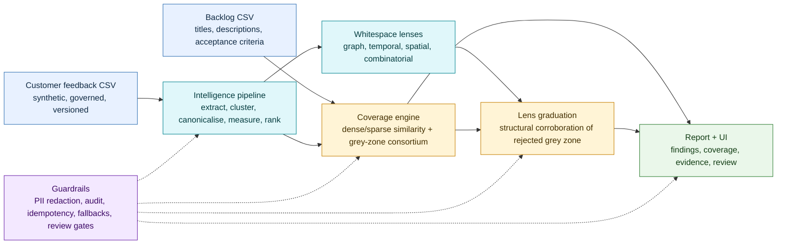

**Business outcome:** teams can see which customer problems are real and repeated, whether the current backlog addresses them, where genuine gaps remain, and which decisions need human review.

**Technical outcome:** every major inference has a version, evidence trail, deterministic fallback and explicit limitation. The system degrades safely instead of failing silently or overstating confidence.

---

## 1. How to read this guide

This document is deliberately both **text-heavy** and **diagram-heavy**.

- Section 2 explains the product thesis and innovation.
- Section 3 maps the repository.
- Section 4 explains runtime architecture.
- Section 5 covers the backend core.
- Section 6 covers the intelligence layer.
- Section 7 covers backlog validation and coverage reporting.
- Section 8 covers the frontend.
- Section 9 covers data, storage and taxonomy.
- Section 10 covers pipelines, deployment and operations.
- Section 11 covers tests and quality gates.
- Section 12 maps the existing documentation.
- Section 13 gives the dated evidence snapshot.
- Section 14 covers governance, robustness and limitations.
- Section 15 gives runbook commands and extension points.

Companion documents:

- [README](../README.md) — quickstart, API summary and provider modes.
- [END_TO_END_PROCESS_FLOW.md](END_TO_END_PROCESS_FLOW.md) — compact value-stream and decision-sequence diagrams.
- [pipeline-algorithms.md](pipeline-algorithms.md) — stage-to-algorithm parameter map.
- [algorithms-and-ui-calculations.md](algorithms-and-ui-calculations.md) — formulas behind UI values.

---

## 2. Product thesis and innovation

### 2.1 The business problem

Customer feedback arrives as messy text: complaints, praise, mixed journeys, repeated symptoms, duplicates, slang, Hinglish, partial dates and PII. Product teams need answers that are more reliable than keyword counts:

- What are the recurring customer problems?
- Which journey steps and features are involved?
- How large and persistent is each problem?
- Which backlog items genuinely address it?
- Which items look similar on paper but would not solve the reported obstacle?
- Which gaps are structurally important enough to escalate?

The repository answers these questions with a pipeline that preserves evidence and separates **customer evidence**, **interpretation**, **business prioritisation** and **human decision**.

### 2.2 The product answer

The system has two sides that meet at coverage validation:

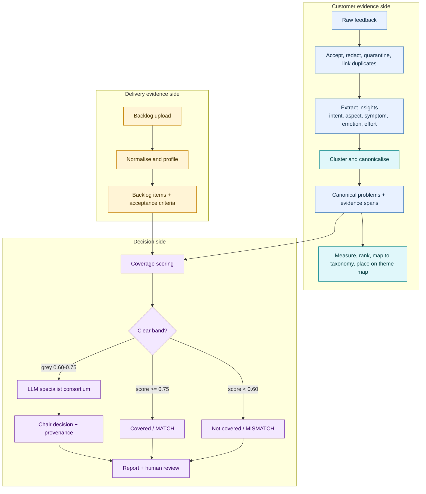

### 2.3 What is genuinely innovative here

| Innovation | What it does | Why it matters |
|---|---|---|
| Evidence-first extraction | Every insight links to a redacted evidence span and keeps source IDs. | Reviewers can challenge a claim by reading the source text. |
| Duplicate linking, not deletion | Exact, near and repeat complaints are connected rather than discarded. | Frequency remains honest; the system does not erase repeated customer pain. |
| Grey-zone consortium | Four specialist lenses plus a chair adjudicate only ambiguous matches. | LLM cost and hallucination risk are confined to the band where deterministic scoring is least certain. |
| Lens-reinforced graduation | Graph/combinatorial structures can promote rejected grey-zone problems when association is strong. | Adds an independent corroboration path without replacing the LLM verdict wholesale. |
| FAMD with governance | Factor analysis is additive, versioned, reviewable and never changes canonical problems. | Advanced analytics can be explored without corrupting operational metrics. |
| Narrative validation | LLM factor narratives are checked for causal language, technical IDs and unsupported claims. | Business-friendly prose does not become an untrusted source of truth. |
| Local-first with cloud migration adapters | SQLite and filesystem now; GCS, BigQuery, Workflows and Terraform scaffolding ready. | Runs cheaply in a PoV while preserving a credible production path. |

### 2.4 The core design principle

The system treats every inference as a **claim with provenance**, not as an unquestionable fact. That is why the code repeatedly stores model names, prompt versions, schema versions, thresholds, input generations, rationale text and review decisions.

---

## 3. Repository map

### 3.1 Top-level structure

| Path | Role |
|---|---|
| `README.md` | Product overview, quickstart, API table, provider modes, troubleshooting. |
| `Makefile` | Developer and CI entrypoints: install, test, lint, build, Docker, smoke run. |
| `pyproject.toml` | Ruff and pytest configuration. |
| `.env.example` | Complete supported settings catalogue with safe placeholders. |
| `backend/` | FastAPI application, persistence, services and intelligence algorithms. |
| `frontend/` | React + TypeScript single-page application. |
| `pipelines/` | Batch worker entrypoint used by local jobs and Cloud Run Jobs. |
| `workflows/` | GCP Cloud Workflows definitions for feedback and backlog stages. |
| `docker/` | Backend, worker and frontend container artifacts plus nginx config. |
| `infra/terraform/` | GCP resource definitions for storage, BigQuery, IAM, Run services and Workflows. |
| `sql/` | BigQuery migrations and dashboard views. |
| `taxonomy/` | Versioned banking journey taxonomy with 12 modules and 62 active nodes. |
| `data/local/` | Local SQLite store and immutable object store. |
| `tests/` | Unit, pipeline, API, backlog, intelligence, FAMD, portfolio and whitespace tests. |
| `docs/` | Deep technical documentation and dated process/component guides. |
| `synthetic_banking_app_feedback_15000.csv` | Primary synthetic dataset covering all 62 taxonomy nodes. |
| `synthetic_banking_app_feedback_1800.csv` | Smaller synthetic fixture for quick runs. |
| `sample_backlog_upload.csv` | Sample backlog with title, description, acceptance criteria and product metadata. |
| `None` | Untracked stray SQLite artifact from a misdirected write; not referenced by configuration. |

### 3.2 Repository mindmap

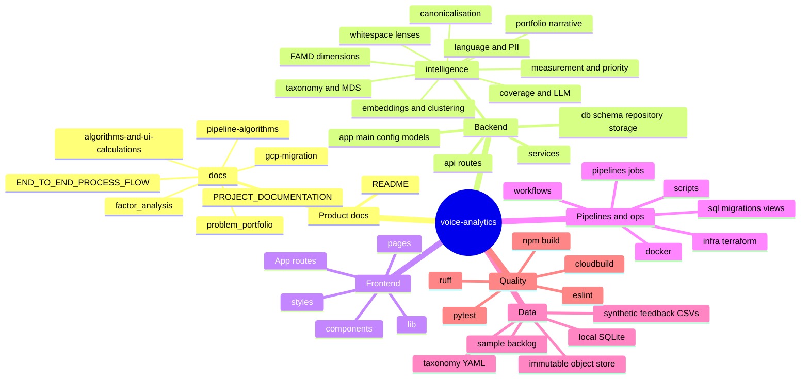

---

## 4. Runtime architecture

### 4.1 Layered view

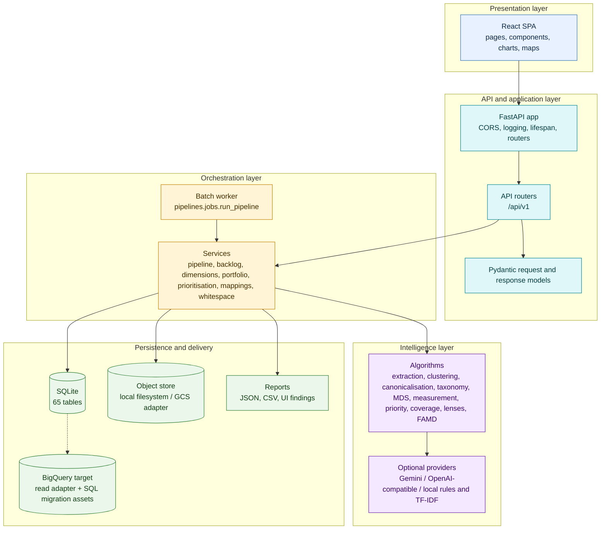

Only the backend is allowed to touch storage and analytics. The frontend is a presentation client and never reads SQLite or the object store directly.

### 4.2 Request and background-run lifecycle

Long jobs are started through API endpoints or the batch worker. They return a `run_id`, a polling path and status metadata. The API also supports idempotency keys so retries do not duplicate work.

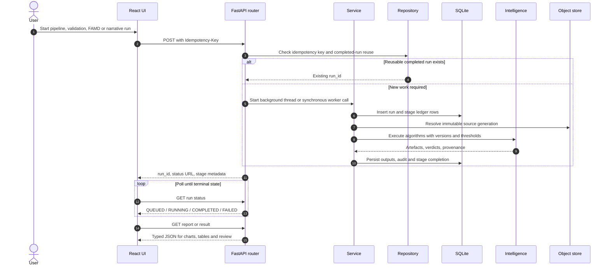

---

## 5. Backend core

### 5.1 Application shell and configuration

| File | Responsibility |
|---|---|
| `backend/app/main.py` | Creates the FastAPI app, configures structured JSON logging, CORS, lifespan, service wiring, router mounting and the root endpoint. |
| `backend/app/config.py` | Typed `Settings` loaded from environment; contains paths, versions, provider choices, thresholds, review roles and feature flags. |
| `backend/app/models.py` | Request and response schemas for pipeline starts, reviews, dimension runs, portfolio runs and prioritisation runs. |
| `backend/app/db.py` | SQLite connection lifecycle and safe additive migrations for older local database files. |
| `backend/app/schema.py` | Canonical SQLite DDL: 65 tables spanning runs, feedback, problems, taxonomy, backlog, validation, audit, FAMD, portfolio and prioritisation. |
| `backend/app/repository.py` | Persistence facade with roughly 131 methods; hides SQL from services and routers. |
| `backend/app/storage.py` | Object-store abstraction with `LocalObjectStore` and `GCSObjectStore` adapters. |

Key configuration ideas:

- `API_PREFIX=/api/v1`, default tenant `demo-bank`.
- Data and object-store roots are configurable.
- Provider modes are explicit for extraction, embeddings, PII, language detection and analytics backend.
- Coverage thresholds: `0.75` for match and `0.60` for mismatch.
- Lens graduation settings at `backend/app/config.py:80-82`:
  - `lens_graduation_enabled=True`
  - `lens_graduation_threshold=0.5`
  - `lens_graduation_signal_threshold=0.6`
- Cached settings avoid repeated environment parsing.
- `GET /api/v1/health` exposes status, environment, object store, provider model, taxonomy version and schema version.

### 5.2 Persistence domains

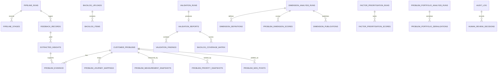

The 65 tables can be understood as these families:

| Domain | Representative tables | Purpose |
|---|---|---|
| Run ledger | `pipeline_runs`, `pipeline_stages`, `app_meta`, `model_execution_history` | Idempotency, stage status, code/schema/model versions and operational history. |
| Feedback foundation | `feedback_records`, `feedback_quarantine`, `feedback_duplicate_candidates`, `ingestion_manifests`, `data_quality_reports` | Accepted rows, rejected rows, duplicate links and quality evidence. |
| Insights and problems | `extracted_insights`, `customer_problems`, `problem_evidence`, `problem_clusters`, `problem_symptoms`, `problem_relationships` | Evidence-backed canonical problem model. |
| Taxonomy and journey | `taxonomy_nodes`, `taxonomy_proposals`, `problem_journey_mappings` | Governed mapping to a versioned banking taxonomy. |
| Measurement and priority | `problem_measurement_snapshots`, `problem_metrics_daily`, `problem_priority_snapshots`, `analytics_problem_daily` | Windowed volume, trend, effort and transparent priority components. |
| Theme map | `problem_mds_runs`, `problem_mds_points`, `problem_mds_neighbors`, `problem_theme_vectors`, `problem_mds_relationships` | Semantic 2-D map; never a severity score. |
| Backlog and validation | `backlog_uploads`, `backlog_items`, `validation_runs`, `validation_reports`, `validation_findings`, `backlog_coverage_matrix`, `backlog_problem_candidates` | Backlog profiling, coverage decisions and report evidence. |
| Review and audit | `review_decisions`, `human_review_decisions`, `report_reviews`, `audit_log` | Human approval trail. |
| FAMD dimensions | `dimension_analysis_runs`, `dimension_definitions`, `problem_dimension_scores`, `dimension_variable_contributions`, `dimension_publications`, `problem_dimension_equations` | Versioned factor analysis and publication control. |
| Portfolio narrative | `problem_portfolio_analysis_runs`, `problem_portfolio_serializations`, `problem_portfolio_narratives`, `problem_narrative_validation` | Signed coefficient matrix and validated narrative. |
| Factor prioritisation | `factor_prioritisation_runs`, `factor_prioritisation_scores`, `factor_prioritisation_evidence`, `factor_semantic_assessments` | Evidence-weighted ranking of factors. |

### 5.3 Immutable object storage

The object store separates a stable content key from immutable generations. A current pointer resolves to the active generation; older generations remain available for reproducibility.

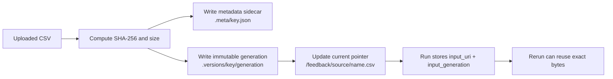

This matters because a run can prove which file bytes it used. It also makes retries and completed-run reuse safe.

### 5.4 API surface

All application routes are under `/api/v1`; the root endpoint is at `/`.

| Area | Routes | Business purpose |
|---|---|---|
| Health and meta | `GET /health`, `GET /meta/source` | Operational status and active source provenance. |
| Feedback sources | `GET/POST /feedback-sources` | Register or list canonical source objects. |
| Feedback pipeline | `POST /feedback-pipelines`, `GET /feedback-pipelines`, `GET /feedback-pipelines/{run_id}` | Start and monitor ingestion-to-publication runs. |
| Feedback analytics | `GET /feedback/summary`, `GET /feedback/options`, `GET /problems`, `GET /problems/{problem_id}`, `GET /priorities`, `GET /problems/{problem_id}/priority`, `GET /problems/{problem_id}/measurement` | Power problems, filters, detail pages and priority views. |
| Theme map | `GET /problem-map`, `POST /problem-map/recompute`, `GET /problem-map/{problem_id}` | MDS coordinates, stress and selected-theme evidence. |
| Taxonomy and journey | `GET /taxonomy`, `GET /taxonomy/proposals`, `POST /taxonomy/proposals/{proposal_id}/review`, `GET /journey` | Taxonomy browsing and proposal governance. |
| Problem review | `POST /problems/{problem_id}/review` | Record auditable human decisions on problems. |
| Backlog uploads | `GET/POST /backlog-uploads`, `POST /backlog-uploads/sample`, `GET /backlog-uploads/{upload_id}`, `GET /backlog-template` | Upload, inspect and template backlog data. |
| Backlog validation | `POST /backlog-uploads/{upload_id}/validate`, `GET /backlog-validation-runs/{run_id}` | Start and monitor validation. |
| Reports | `GET /backlog-validation-reports`, `GET /backlog-validation-reports/{report_id}`, `GET /backlog-validation-reports/{report_id}/coverage`, `GET /backlog-validation-reports/{report_id}/download`, `POST /backlog-validation-reports/{report_id}/review` | Findings, coverage matrix, export and review. |
| Quality and diagnostics | `GET /data-quality`, `GET /duplicates`, `GET /diagnostics`, `GET /problem-relationships`, `GET /admin/overview` | Trust, quality and operational visibility. |
| Problem dimensions | `GET /problem-dimensions/status`; `GET/POST /problem-dimensions/runs`; `GET /problem-dimensions/runs/{run_id}`; `GET /problem-dimensions/runs/{run_id}/dimensions/{dimension_id}`; `GET /problem-dimensions/runs/{run_id}/problems/{problem_id}`; `GET /problem-dimensions/runs/{run_id}/interpretation`; `GET /problem-dimensions/runs/{run_id}/dimensions/{dimension_id}/interpretation`; `POST /problem-dimensions/runs/{run_id}/interpretation/regenerate`; `POST /problem-dimensions/runs/{run_id}/problems/{problem_id}/name-factors`; `GET/POST /problem-dimensions/runs/{run_id}/narrative-serialization`; `GET /problem-dimensions/runs/{run_id}/coefficients`; `GET /problem-dimensions/runs/{run_id}/coefficients.csv`; `GET /problem-dimensions/runs/{run_id}/variables`; `GET /problem-dimensions/runs/{run_id}/problems/{problem_id}/profile`; `GET /problem-dimensions/latest`; `GET /problem-dimensions/latest/dimensions/{dimension_id}`; `GET /problem-dimensions/latest/problems/{problem_id}`; `POST /problem-dimensions/runs/{run_id}/dimensions/{dimension_id}/review`; `POST /problem-dimensions/runs/{run_id}/publish` | Full FAMD lifecycle from run to review and publication. |
| Factor-analysis alias | `GET /factor-analysis/status`; `GET/POST /factor-analysis/runs`; `GET /factor-analysis/runs/{run_id}`; `GET /factor-analysis/runs/{run_id}/coefficients`; `GET /factor-analysis/runs/{run_id}/variables`; `GET /factor-analysis/runs/{run_id}/problems/{problem_id}` | Backward-compatible factor endpoints. |
| Factor prioritisation | `GET /factor-prioritisation/status`; `GET/POST /factor-prioritisation/runs`; `GET /factor-prioritisation/runs/latest`; `GET /factor-prioritisation/runs/{run_id}`; `GET /factor-prioritisation/runs/{run_id}/scores`; `GET /factor-prioritisation/runs/{run_id}/factors/{factor_id}`; `POST /factor-prioritisation/runs/{run_id}/factors/{factor_id}/semantic-assessment/review` | Evidence-weighted factor ranking and semantic review. |
| Portfolio | `GET /problem-portfolio/status`; `GET/POST /problem-portfolio/runs`; `GET /problem-portfolio/runs/{run_id}`; `GET /problem-portfolio/runs/{run_id}/serialization`; `GET /problem-portfolio/runs/{run_id}/narrative`; `POST /problem-portfolio/runs/{run_id}/narrative/regenerate`; `GET /problem-portfolio/runs/{run_id}/validation`; `GET /problem-portfolio/latest`; `GET /problem-portfolio/latest/narrative` | Signed coefficient matrix and narrative lifecycle. |
| Discovery | `GET /mappings`, `GET /whitespace` | End-to-end evidence graph and whitespace lens results. |
| Root | `GET /` | Lightweight application identity response. |

### 5.5 Service layer

| File | Service | Responsibility |
|---|---|---|
| `services/pipeline.py` | `FeedbackPipelineService` | Orchestrates the full feedback pipeline and stage ledger. |
| `services/ingestion.py` | Ingestion helpers | Parse, validate, quarantine, redact and profile feedback and backlog input. |
| `services/backlog.py` | `BacklogValidationService` | Profiles backlog uploads, validates against canonical problems or factor rankings, builds reports and lens graduation provenance. |
| `services/problem_dimensions.py` | `ProblemDimensionService` | Starts, executes, reviews, narrates and publishes FAMD runs. |
| `services/factor_prioritisation.py` | `FactorPrioritisationService` | Resolves weights, runs scoring and handles semantic assessment review. |
| `services/problem_portfolio.py` | `ProblemPortfolioService` | Serialises approved dimensions and validates/regenerates narrative. |
| `services/mappings.py` | Mapping graph service | Builds feedback → signal → problem → backlog → coverage graph data. |
| `services/mds.py` | MDS service | Builds theme coordinates, neighbours and relationships. |
| `services/whitespace.py` | `WhitespaceDiscoveryService` | Runs lens discovery and computes lens associations for coverage graduation. |

Reuse rules are important:

- Feedback reruns can reuse a completed run when input URI/generation and versions match.
- FAMD runs reuse compatible completed runs by feedback run plus schema/method version.
- Portfolio runs reuse compatible FAMD and serialisation versions.
- Prioritisation runs reuse compatible FAMD runs, scoring model and serialised weights.
- Long work runs in daemon threads; key services also expose synchronous methods for tests and workers.

---

## 6. Intelligence layer

The intelligence layer is the analytical heart of the repository. It contains roughly 62 Python files across language utilities, extraction, embeddings, clustering, canonicalisation, taxonomy, MDS, measurement, priority, coverage, FAMD, portfolio narrative, factor prioritisation and whitespace lenses.

### 6.1 Intelligence map

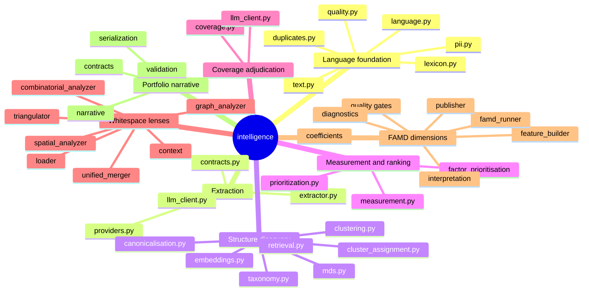

### 6.2 End-to-end analytical flow

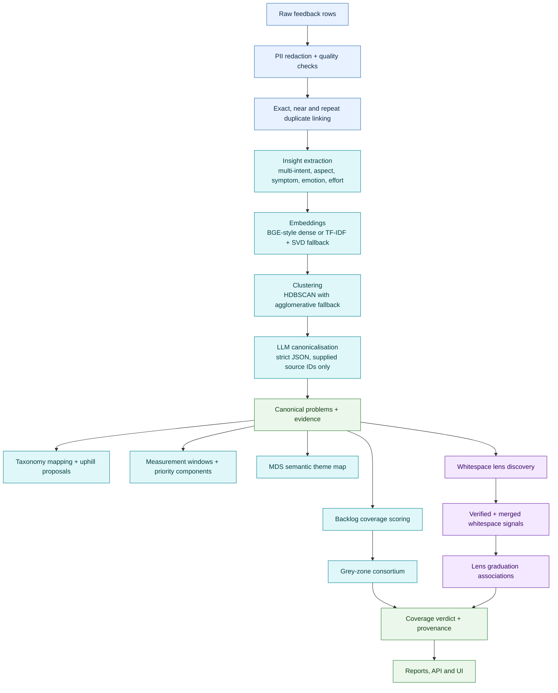

### 6.3 Language foundation and extraction

| Module | Purpose |
|---|---|
| `intelligence/text.py` | Normalisation and pattern helpers used by deterministic extraction. |
| `intelligence/lexicon.py` | Banking intent, aspect and symptom vocabulary. |
| `intelligence/language.py` | Metadata-only ISO language detection; never translates or overwrites text. |
| `intelligence/pii.py` | Regex, Presidio or hybrid PII redaction; Presidio failure falls back to regex. |
| `intelligence/quality.py` | Additive quality states: `PASS`, `WARN`, `FAIL`, `NOT_AVAILABLE`; length and schema checks. |
| `intelligence/duplicates.py` | Exact SHA-256, MinHash-LSH near duplicates and repeat-complaint linking. |
| `intelligence/extractor.py` | Deterministic or LLM-assisted extraction of sentence-level insights with evidence spans. |
| `intelligence/providers.py` | Evidence-first extraction prompt, `PROMPT_VERSION="extraction-2.0"`. |
| `intelligence/contracts.py` | Typed sentiment, effort, outcome, relationship and alignment models; original text is not returned by APIs. |

Business meaning:

- The system does not erase low-quality rows or duplicates; it records their status and links them.
- Evidence spans let reviewers verify an insight quickly.
- Extraction prompts forbid root cause, blame, churn, revenue and compliance claims that are not in the text.
- Insight IDs are content-derived, for example `IN-` plus a truncated SHA-1 of feedback ID, evidence and labels.

### 6.4 Embeddings, clustering and canonicalisation

| Module | Purpose |
|---|---|
| `intelligence/embeddings.py` | Local TF-IDF + LSA embedder (`tfidf-svd-96-v1`), optional Sentence Transformer and Gemini/Vertex adapters. |
| `intelligence/retrieval.py` | Hybrid dense plus sparse retrieval with optional reranker. |
| `intelligence/cluster_assignment.py` | Assigns insights to clusters using embeddings and thresholds. |
| `intelligence/clustering.py` | HDBSCAN with deterministic agglomerative fallback. |
| `intelligence/canonicalisation.py` | LLM-led canonical problem naming with strict JSON and supplied source IDs only. |
| `intelligence/taxonomy.py` | YAML taxonomy loading, mapping logic and proposals for unmapped evidence. |
| `intelligence/mds.py` | Metric MDS for a semantic theme map, with stress and neighbour data. |

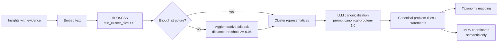

Guardrails:

- TF-IDF fallback keeps the system usable offline.
- HDBSCAN fallback prevents total failure on small or awkward datasets.
- Canonicalisation cannot invent source IDs.
- MDS axes are semantic and rotatable; they are never treated as severity.
- Taxonomy proposals support an open-set workflow without silently forcing a wrong mapping.

### 6.5 Measurement and prioritisation

`measurement.py` and `prioritization.py` turn repeated problems into explicit metrics:

- Windows: lifetime, 90 days, 30 days and previous 30 days.
- Missingness: `NO_DATA` and `INSUFFICIENT_DATA` are preserved.
- Priority components:
  - customer impact `0.30`
  - business risk `0.30`
  - operational burden `0.15`
  - trend `0.15`
  - strategic fit `0.10`
- Sentiment never becomes a churn claim.
- Risk terms are indicators, not proof of regulatory breach.
- Co-occurrence is not presented as causality.

This is important for business trust: a small number of complaints is shown as small or insufficient evidence, not disguised as zero risk.

### 6.6 Coverage scoring and grey-zone consortium

`intelligence/coverage.py` is the decision core for backlog validation.

1. It builds comparable text from title, statement, description, acceptance criteria, product area, intended outcome, customer intent, target feature, target journey and functional scope.
2. It computes cosine similarity from coverage embeddings.
3. It clips scores from `[-1, 1]` to `[0, 1]`.
4. For each canonical problem, it selects the closest backlog item.
5. It applies thresholds:
   - `>= 0.75` → `COVERED` / `MATCH`
   - `< 0.60` → `NOT_COVERED` / `MISMATCH`
   - `0.60–0.75` → grey-zone consortium
6. Grey-zone matched problems become `ADDRESSES`; rejected grey-zone and clear mismatches become `NO_CLEAR_RELATIONSHIP`.

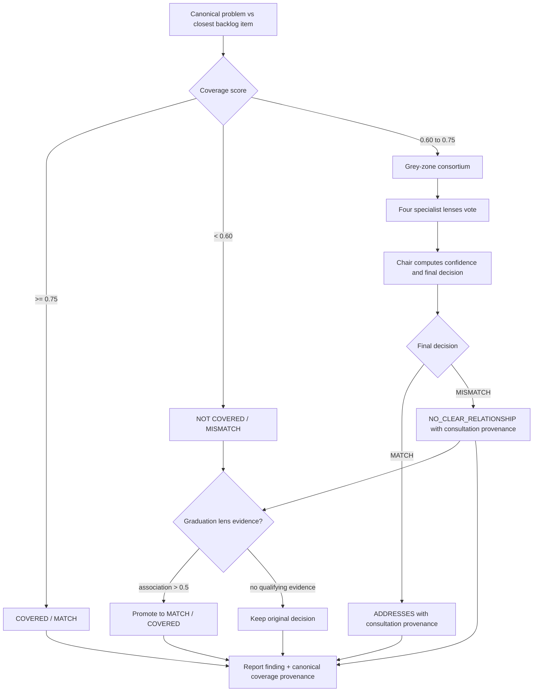

The consortium roles are:

| Role | Lens |
|---|---|
| Customer Experience Analyst | Customer-observable symptoms, journey step and reported obstacle. |
| Backlog Delivery Lead | Whether backlog scope and acceptance criteria would resolve the obstacle. |
| Risk and Controls Reviewer | Unresolved gaps, contradictions and false-positive coverage risk. |
| Journey Taxonomy Specialist | Journey and feature alignment. |
| Adjudication Chair | Majority decision plus optional LLM rationale. |

```mermaid
sequenceDiagram
    autonumber
    participant COV as Coverage engine
    participant CON as Grey-zone consortium
    participant LLM as Structured LLM client
    participant RPT as Report

    COV->>CON: Grey-zone pair + whitelisted fields
    Note over COV,CON: Only canonical and backlog fields plus score and band are passed
    loop Each configured specialist role
        CON->>LLM: generate_json with strict decision schema
        alt Valid JSON decision
            LLM-->>CON: MATCH/MISMATCH, confidence, evidence, gap assessment
        else Invalid or unavailable
            LLM-->>CON: LLMUnavailable or invalid payload
            CON->>CON: Deterministic heuristic vote
        end
    end
    CON->>CON: Majority vote; chair confidence is mean confidence
    opt Chair enabled
        CON->>LLM: Adjudicate with rationale <= 400 chars
        LLM-->>CON: Chair decision or invalid output
        Note over CON: Invalid chair output falls back to majority
    end
    CON-->>COV: final_decision, confidence, rationale, agent details
    COV->>RPT: Verdict with model, provider, thresholds and provenance
```

Fallback behaviour:

- Heuristic fallback: `MATCH` if score is at or above the midpoint or shared token overlap is at least 6; otherwise `MISMATCH`.
- Invalid agent JSON becomes heuristic fallback.
- `LLMUnavailable` degrades to deterministic chair.
- Batch processing injects missing agents deterministically.

`llm_client.py` adds key rotation, model fallback, exponential backoff with jitter, provider resolution and strict JSON validation. All failures raise `LLMUnavailable`, allowing callers to degrade safely.

### 6.7 Whitespace lens discovery

Whitespace discovery asks a different question from coverage: not "does this backlog item cover this problem?" but "where are structurally important unmet needs hiding?"

It loads persisted run, report and upload data only, then runs three lens families.

| Family | Lens | Main signal | Notes |
|---|---|---|---|
| Graph | `GRAPH_BRIDGE` | Journey↔aspect graph betweenness, at least 3 uncovered journeys, at least 10 feedbacks. | Eligible for graduation. |
| Graph | `GRAPH_TEMPORAL` | Per-customer symptom transitions within 7 days, count ≥ 5, lift ≥ 2.0. | Discovery only. |
| Spatial | `SPATIAL_VOID` | KDE of pain minus projected backlog KDE, local maxima and void radius checks. | Discovery only; no spatial signals in current snapshot. |
| Combinatorial | `COMBINATORIAL_LATTICE` | Journey×intent and open-set intent×symptom holes, effort thresholds, Poisson residual boost. | Eligible for graduation. |
| Combinatorial | `COMBINATORIAL_NMF` | NMF themes with effort threshold and low coverage among linked problems. | Discovery only. |

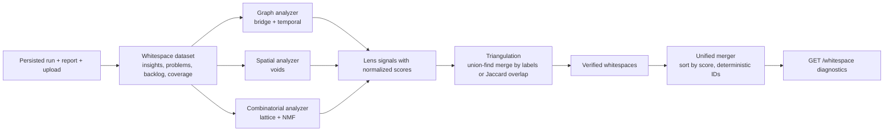

Triangulation score:

```text
whitespace_score =
  0.35 * graph_signal
+ 0.30 * spatial_signal
+ 0.20 * combinatorial_signal
+ 0.15 * (1 - backlog_coverage)
```

The old blanket 2-of-3 family requirement was removed. A single-family cluster can survive if the evidence is strong. This was intentional: requiring three families was too restrictive for sparse but real gaps.

### 6.8 Lens graduation

Lens graduation is the latest and most delicate feature. It can only change a narrow class of decisions:

- The canonical problem must be in the grey zone.
- The LLM consortium final decision must be `MISMATCH`.
- The corroborating signal must come from `GRAPH_BRIDGE` or `COMBINATORIAL_LATTICE`.
- That signal's internal `normalized_score` must be above `0.6`.
- The signal-to-problem association must be above `0.5`.

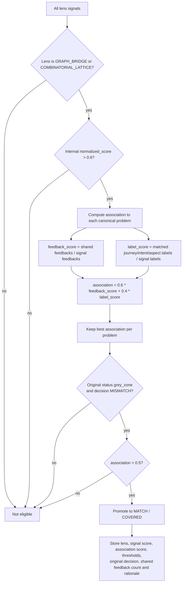

Important correction from the implementation history: the `0.6` threshold belongs to the **signal's internal score**, not the canonical problem's grey-zone coverage score. The `0.5` threshold belongs to the **association score**.

When graduation happens, `validation_findings` records the rationale and `report_json.canonical_coverage[].lens_graduation` records full provenance. The UI shows a violet "Lens graduated" badge.

### 6.9 FAMD problem dimensions

The FAMD subsystem is an additive analytical layer over canonical problems. It does not change canonical problems, priority, MDS coordinates or coverage.


Governance details:

- Optional EFA needs at least 5 rows and 3 numeric features and is never independently publishable.
- LLM nomenclature has no deterministic fallback name; if unavailable, review remains pending.
- Prompts treat customer text as untrusted and forbid causality, revenue, churn and regulatory claims.
- Publication requires review, approval and factor names.

### 6.10 Factor prioritisation and portfolio narrative

Factor prioritisation scores dimensions with configurable weights:

| Component | Default weight |
|---|---:|
| Prevalence | `0.30` |
| Statistical strength | `0.25` |
| Representation | `0.25` |
| Semantic assessment | `0.20` |

Scores are normalised to `0–100`; missing evidence becomes `UNKNOWN`. Membership uses `|coordinate| >= 1.0`, with a legacy provisional fallback.

Portfolio serialization uses only approved and published dimension definitions. The narrative agent names and describes every retained factor from all problem equations and taxonomy context. Deterministic validation rejects technical IDs, causal language and unsupported zero claims for missing data.

---

## 7. Backlog validation and reporting

Backlog validation combines retrieval, explanation, coverage scoring, LLM adjudication, lens graduation and human review.

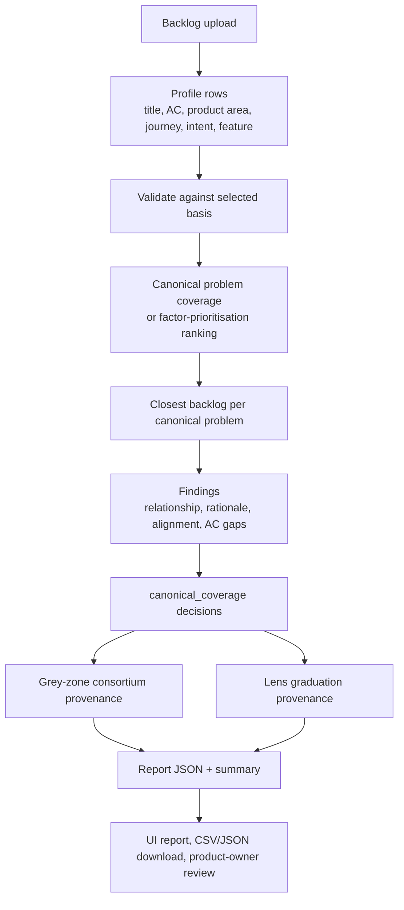

The report JSON contains:

| Key | Meaning |
|---|---|
| `report_id`, `validation_run_id`, `upload_id`, `feedback_run_id` | Identity and lineage. |
| `validation_basis`, `versions` | Method and version provenance. |
| `backlog_items` | Normalised backlog profiles. |
| `findings` | Problem-to-backlog explanations, relationship, alignment, evidence and AC gaps. |
| `canonical_coverage` | One decision row per canonical problem, including grey-zone and lens provenance. |
| `summary` | Counts, coverage status, decisions, retrieval provider and thresholds. |
| `limitations` | Explicit warnings, including the fact that co-occurrence is not causality. |
| `uncovered_high_evidence_problems` | Priority shortlist of gaps with strong evidence. |

The validator never auto-approves or auto-rejects a backlog. It produces a reviewable decision package.

---

## 8. Frontend

### 8.1 Toolchain

| File | Role |
|---|---|
| `frontend/package.json` | ESM React app; scripts for `dev`, `build`, `preview`, `lint`, `format`. |
| `frontend/vite.config.ts` | Vite React plugin, port 5173, preview 4173, `/api` proxy to backend port 8000. |
| `frontend/tsconfig.json` | Strict TypeScript, ES2022/DOM, bundler resolution, `react-jsx`. |
| `frontend/.eslintrc.cjs` | TypeScript and React Hooks linting. |
| `frontend/index.html` | Document shell, metadata and `#root`. |
| `frontend/src/main.tsx` | Mounts `<App/>` in StrictMode and imports global CSS. |
| `frontend/src/styles.css` | Global design system with tokens, components, responsive rules and animations. |

Key dependencies: React 18.3.1, React Router 6.28.1, Recharts 2.15.0, lucide-react 0.468.0, TypeScript 5.7.2 and Vite 6.0.7.

### 8.2 Route map


All routes are nested inside `Layout`. `OverviewPage` and `RunsPage` exist but are not currently routed.

| Route | Page | Purpose |
|---|---|---|
| `/`, `/journey` | `JourneyPage` | Explore the banking taxonomy tree and evidence-relative bars. |
| `/problems` | `ProblemsPage` | Search and filter canonical problems with URL-backed state. |
| `/problems/:problemId` | `ProblemDetailPage` | Evidence, measurement, priority, FAMD profile and review. |
| `/themes` | `ThemeMapPage` | MDS scatter/bubble map and selected-theme evidence. |
| `/dimensions`, `/dimensions/:dimensionId` | `DimensionsPage`, `DimensionDetailPage` | FAMD run, review, coefficient and interpretation views. |
| `/portfolio` | `PortfolioPage` | Signed coefficient matrix and factor narratives. |
| `/prioritization` | `PrioritizationPage` | Factor scores, formula evidence and semantic review. |
| `/mappings` | `MappingsPage` | End-to-end evidence graph and flow view. |
| `/backlog` | `BacklogPage` | Uploads, validation start and item-level issues. |
| `/reports/:reportId` | `ReportPage` | Coverage findings, downloads, limitations, review and lens badge. |

### 8.3 Pages

| File | What it does |
|---|---|
| `pages/JourneyPage.tsx` | Fetches `/journey`; renders module cards, expandable taxonomy tree, evidence bars and links into filtered problems. |
| `pages/ProblemsPage.tsx` | Fetches problems and options; URL-driven search with 320 ms debounce, journey/status/sort filters and pagination. |
| `pages/ProblemDetailPage.tsx` | Shows windowed metrics, priority components, FAMD profile, redacted evidence and a seven-way review form with history. |
| `pages/ThemeMapPage.tsx` | Recharts bubble map: size is evidence, colour is priority, stroke is growth, dashed border means uncovered. Handles no-run, disabled and insufficient-theme states. |
| `pages/MappingsPage.tsx` | Searchable node picking, Flow/Detail toggle, mapped-only and relationship filters, kind-specific detail panels. Current worktree adds signal and coverage data plus flow view. |
| `pages/DimensionsPage.tsx` | Starts FAMD runs, polls progress, shows gates/scree/stability, supports approve/rename/revise/reject and publish. |
| `pages/DimensionDetailPage.tsx` | Shows variable/category contributions, trend tiles, review provenance, top problems and association-not-causation caveats. |
| `pages/PortfolioPage.tsx` | Runs narrative serialization, shows factor cards, signed coefficient table, representative problems and run history. |
| `pages/PrioritizationPage.tsx` | Starts scoring, polls status, shows ranked components and supports semantic assessment review. |
| `pages/BacklogPage.tsx` | Starts validation with idempotency key, polls run, navigates to report and shows upload/item issues. |
| `pages/ReportPage.tsx` | Shows factor or problem-based report mode, findings, relationship/alignment bars, downloads, limitations, review timeline and violet lens-graduation badge. |
| `pages/OverviewPage.tsx`, `pages/RunsPage.tsx` | Existing but unrouted: KPI/source view and admin run list. |

### 8.4 Reusable components and libraries

| Path | Role |
|---|---|
| `components/Layout.tsx` | Collapsible sidebar, mobile drawer, source provenance panel, status pills and synthetic-data warning. |
| `components/ui.tsx` | `PageHeader`, `Card`, `StatCard`, `Badge`, `Spinner`, `ErrorState`, `EmptyState`, `Progress`, `Skeleton`, relationship tone mapping. |
| `components/FilterBar.tsx` | URL-backed date, source, platform and journey filters. |
| `components/Charts.tsx` | Recharts trend, sentiment/journey, source donut and rating charts. |
| `components/MappingGraph.tsx` | Canvas four-column graph with zoom, pan, search rings, focus and path highlighting. |
| `components/MappingFlow.tsx` | Untracked worktree component; SVG five-stage flow with ribbon widths and clickable problem/backlog nodes. |
| `lib/api.ts` | `API_BASE`, typed `api<T>()`, idempotent POST, form POST and blob downloads. |
| `lib/useFetch.ts` | Loading/error state, request-id stale-response guard and polling helper. |
| `lib/format.ts` | Safe number, percent, date, label, truncation and class-name helpers. |
| `lib/types.ts` | Large API contract library; current worktree adds `lens_graduation` and mapping flow/coverage types. |
| `lib/mappingGraph.ts` | Palettes, indexed link lookup and scored search. |

### 8.5 UX journey

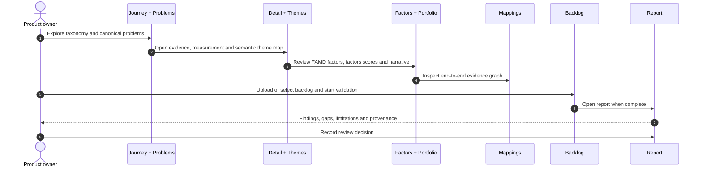

The UI repeatedly positions evidence as input to judgement, not as automatic truth. It shows synthetic-data warnings, IDs, limitations and review status.

### 8.6 Frontend robustness and known gaps

Strengths:

- Stale-request guard in `useFetch`.
- Loading, empty and retryable error states.
- Idempotency keys for mutations.
- Polling for long runs.
- Confirmations for publish and destructive actions.
- Responsive layout with many breakpoints.
- SVG flow has an image role and some aria labels.
- Synthetic data warning persists in `Layout`.

Gaps to keep visible:

- Some option-list fetches silently swallow errors.
- Canvas mapping graph is mouse-oriented and not keyboard navigable.
- `MappingFlow` nodes lack full keyboard roles.
- No global route fallback.
- `OverviewPage` and `RunsPage` are unreachable.
- No global reduced-motion rule.
- One current lint warning: unused `Play` import in `PortfolioPage.tsx`.

---

## 9. Data, storage and taxonomy

### 9.1 Feedback datasets

| File | Scale | Purpose |
|---|---:|---|
| `synthetic_banking_app_feedback_15000.csv` | 15,000 rows | Primary synthetic dataset covering all 62 taxonomy nodes. |
| `synthetic_banking_app_feedback_1800.csv` | 1,800 rows | Quick local fixture. |
| `sample_backlog_upload.csv` | 8 columns | Backlog validation demonstration. |

The generator `scripts/generate_feedback_dataset.py` is deterministic and taxonomy-driven. It injects module weights, PII-shaped strings, Hinglish and duplicates so the pipeline can be tested realistically without customer data.

### 9.2 Taxonomy

`taxonomy/banking_taxonomy_v1.yaml` defines version `1.0.0`, 12 modules and 62 active feature nodes. Each node has identifiers, synonyms and parents, for example `payments.upi`, `auth.otp` and `navigation.performance`.

The taxonomy is used for:

- Mapping insights to known journey nodes.
- Producing proposals for unmapped evidence.
- Filtering UI views.
- Label matching in lens associations.
- Prompt context for factor nomenclature and narratives.

### 9.3 Local object store layout

```text
data/local/
  bci.db
  object_store/
  objects/
    .meta/
      feedback__source__<file>.json
      backlogs__uploads__<tenant>__<upload>__<file>.json
    .versions/
      feedback/source/<file>/<generation>/
      backlogs/uploads/<tenant>/<upload>/<file>/<generation>/
    feedback/source/<file>/
    backlogs/uploads/<tenant>/<upload>/<file>/
```

Each `.meta` sidecar records key, URI, generation, size, SHA-256, upload time and content type. This is the foundation for the run's `input_uri` and `input_generation`.

---

## 10. Pipelines, deployment and operations

### 10.1 Batch worker

`pipelines/jobs/run_pipeline.py` is the command-line worker used locally and by Cloud Run Jobs.

Modes:

- `feedback`
- `backlog`
- `dimensions`

Important flags include `--input-uri`, `--generation`, `--force`, `--stage`, `--upload-id`, `--validation-run-id`, `--feedback-run-id` and `--max-components`. Failures return exit code `1`; missing upload ID returns `2`.

### 10.2 Feedback and backlog workflow stages

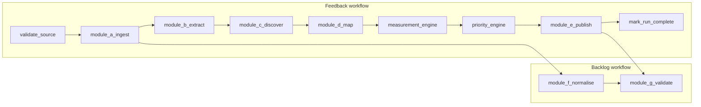

The runtime ledger also records `mds_engine` on the API side. Tests assert nine feedback stages including MDS; the workflow YAML uses `mark_run_complete` as its terminal stage. This is a documentation/test nuance to be aware of, not a data-loss issue.

### 10.3 Cloud Run orchestration

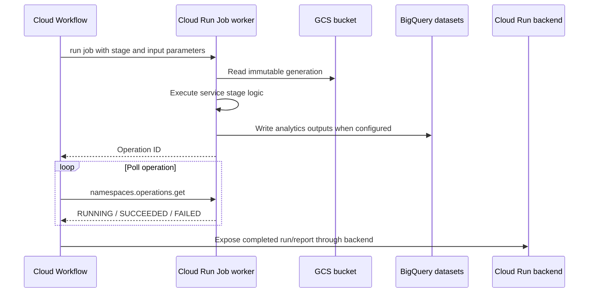

### 10.4 Containers and deployment assets

| Path | Role |
|---|---|
| `docker/Dockerfile.backend` | Python 3.13 slim, non-root `appuser`, uvicorn on port 8000, healthcheck. |
| `docker/Dockerfile.worker` | Python 3.13 slim, `PYTHONPATH=/app/backend:/app`, non-root `worker`, entrypoint is the batch worker. |
| `docker/Dockerfile.frontend` | Node build stage plus nginx 1.27 runtime with healthcheck. |
| `docker/nginx.conf` | Proxies `/api/` to backend, caches assets, falls back to SPA `index.html`. |
| `docker-compose.yml` | Backend plus frontend; health-gated startup and `bci-data` volume. |
| `cloudbuild.yaml` | Ten CI/CD steps: tests, frontend build, three image builds, pushes, three deploys and two workflow deploys. |
| `infra/terraform/main.tf` | Enables APIs, bucket, 7 BigQuery datasets, Artifact Registry, service accounts, Run services, worker job and Workflows. |
| `scripts/gcp_deploy.sh` | Terraform apply, Cloud Build submit, SQL script. |
| `scripts/gcp_sql.sh` | Renders project ID into BigQuery migrations and views. |
| `scripts/gcp_upload_and_run.sh` | Uploads CSV, captures generation and starts feedback workflow. |
| `scripts/gcp_teardown.sh` | Requires `FORCE=1`; deletes deployed resources. |

Deployment posture:

- Local and Docker Compose are the tested path.
- GCP assets are scaffolding; README explicitly says no resources were deployed as part of the PoV.
- Terraform enables allUsers invoker bindings for demo Run services; restrict before production.
- Secret Manager placeholder has no secret version.
- `DATA_DIR=/tmp/bci` in cloud deployment would be ephemeral and needs a durable path.
- Review endpoints currently trust `reviewer` supplied in the request body.

### 10.5 SQL assets

| Path | Role |
|---|---|
| `sql/migrations/001_bigquery_schema.sql` | Base partitioned and clustered tables across ops, staging, curated, intelligence, taxonomy, backlog and validation. |
| `sql/migrations/002_*` | Additive module columns, quality, metrics, review, retrieval and coverage tables. |
| `sql/migrations/003_*` | MDS vectors, runs, points and neighbours. |
| `sql/migrations/004_*` | FAMD runs, scores, definitions, contributions, membership and trends. |
| `sql/migrations/005_*` | Signed coefficients, shares and equations. |
| `sql/migrations/006_*` | Portfolio runs, nomenclature, profiles, serializations, narratives and validation. |
| `sql/migrations/007_*` | Factor prioritisation runs, scores, evidence and semantic assessments. |
| `sql/views/001_dashboard_views.sql` | Eight dashboard views for problem overview, journey/sentiment, findings, relationships, run health and theme map. |

---

## 11. Tests and quality gates

### 11.1 Test map

```mermaid
flowchart TB
    A["tests/conftest.py<br/>temp CSVs + app client"] --> B["Pipeline tests"]
    A --> C["API tests"]
    A --> D["Backlog/report tests"]
    E["Unit and intelligence tests"] --> F["Intelligence module tests"]
    E --> G["FAMD tests"]
    E --> H["Portfolio tests"]
    E --> I["Whitespace tests"]
    E --> J["LLM interpretation tests"]
    B --> K["99 passing tests"]
    C --> K
    D --> K
    F --> K
    G --> K
    H --> K
    I --> K
    J --> K
```

| Test area | Files | What it protects |
|---|---|---|
| Fixtures | `tests/conftest.py` | Temp feedback with PII, empty text, bad date and duplicate; backlog rows; one completed pipeline. |
| Pipeline | `tests/test_pipeline.py` | Ingest counts, quarantine, PII redaction, evidence-backed problems, stage ledger, admin overview. |
| API | `tests/test_api.py` | Health, meta, review audit, upload idempotency, report generation, theme map. |
| Extraction | `tests/test_extraction.py` | Evidence spans, journey mapping, positive feedback handling, filler suppression. |
| Backlog | `tests/test_backlog.py` | Criteria splitting, quarantine, findings, relationships, coverage, CSV download, review. |
| Intelligence modules | `tests/test_intelligence_modules.py` | Duplicates, missing-data handling, advanced-method refusal, PII/language fallbacks, explicit windows. |
| MDS | `tests/unit/test_mds.py` | Cosine distance, centroid mapping, neighbours, insufficient themes, two-theme projection. |
| Pipeline changes | `tests/intelligence/test_pipeline_v2_changes.py` | TF-IDF normalisation, cluster cap, canonicalisation dedup, Gemini key rotation, grey-zone consortium and lens graduation. |
| FAMD | `tests/intelligence/problem_dimensions/` | Features, leakage guards, FAMD reproducibility, bootstrap/EFA, coefficients, publication gates, API lifecycle and LLM interpretation. |
| Portfolio | `tests/intelligence/portfolio/` | Serialization with missing values, narrative validation, regeneration and bounded context. |
| Whitespace | `tests/intelligence/whitespace/` | Graph, temporal, spatial, lattice, NMF, triangulator, lens ranking and empty-response determinism. |

### 11.2 Verified commands on 2026-11-17

```bash
.venv/bin/python -m pytest -q
.venv/bin/python -m ruff check backend tests pipelines
cd frontend && npm run lint
cd frontend && npm run build
```

Results:

- Pytest: **99 tests pass**.
- Ruff: **All checks passed**.
- ESLint: **0 errors**, one pre-existing warning for unused `Play` in `frontend/src/pages/PortfolioPage.tsx:5:3`.
- Vite build: **successful**, with only chunk-size advisory warnings.

---

## 12. Documentation map

| Document | What it covers |
|---|---|
| `README.md` | Product overview, architecture sketch, local/Docker/GCP commands, API summary, troubleshooting. |
| `PROJECT_DOCUMENTATION.md` | Very large end-to-end guide: concepts, modules, API, UI, data model, config, testing, deployment and governance. |
| `docs/END_TO_END_PROCESS_FLOW.md` | Two focused Mermaid diagrams: value stream and decision sequence. |
| `docs/pipeline-algorithms.md` | Stage-to-algorithm and parameter mapping. |
| `docs/algorithms-and-ui-calculations.md` | Per-page UI formula explanations. |
| `docs/baseline-assessment.md` | Baseline versus implemented status. |
| `docs/gcp-migration.md` | GCP runbook, status, blocking work, provisioning and teardown. |
| `docs/factor_analysis.md` | FAMD coefficients and interpretation. |
| `docs/problem_dimension_interpretation.md` | LLM factor naming and interpretation. |
| `docs/problem_portfolio.md` | Signed coefficient matrix and narrative serialization. |
| `MAPPING_AND_F11_WHITE_SPACE.md` | Mapping graph and F11 whitespace caveats. |
| `prioritization.md`, `document.md` | Factor evidence framework and prioritisation measures. |
| `banking_customer_intelligence_gcp_build_prompt.md` | Build specification and acceptance criteria. |
| `synthetic_banking_app_feedback_README.md` | Synthetic dataset provenance. |
| `docs/ARCHITECTURE.md` | Legacy/unrelated ILRP-app architecture reference; use with caution for this repository. |

---

## 13. Dated evidence snapshot — 17 November 2026

### 13.1 Latest run and report

| Item | Value |
|---|---|
| Latest feedback run | `RUN-20261117113727-a1d193` |
| Feedback source | `synthetic_banking_app_feedback_15000.csv` |
| Feedback run status | `completed` |
| Feedback rows processed by whitespace loader | `15,000` |
| Latest validation report | `RPT-4c73ffb3221d` |
| Validation basis | `canonical_problem_coverage` |
| Backlog items | `7` |
| Canonical problems | `6,973` |
| Findings | `56` |
| Relationships | `18 ADDRESSES`, `38 NO_CLEAR_RELATIONSHIP` |
| Coverage model | `tfidf-svd-96-v1` fallback |
| Match / mismatch thresholds | `0.75` / `0.60` |
| Grey-zone agents | `3` |

```mermaid
pie showData
    title Canonical problem coverage status
    "Covered" : 33
    "Grey zone" : 66
    "Not covered" : 6874
```

| Coverage status | Count | Meaning |
|---|---:|---|
| `covered` | `33` | Clear match or promoted decision. |
| `grey_zone` | `66` | Ambiguous band sent to consortium. |
| `not_covered` | `6,874` | Clear mismatch. |
| Lens graduation | `0` | No problem qualified for graduation in this report. |
| High-evidence uncovered | `12` | Uncovered problems with strong evidence worth review. |

### 13.2 Grey-zone outcome

| Outcome | Count |
|---|---:|
| Grey-zone problems moved to `MATCH` | `34` |
| Grey-zone problems retained as `MISMATCH` | `32` |
| Total grey-zone cases | `66` |

The latest report's grey-zone deliberation records show deterministic fallback behaviour in this local run: agent `model` fields are null and confidence is `0.5`. This is expected when no LLM provider is configured.

### 13.3 Whitespace and lens association snapshot

Recomputed from the persisted run/report/upload:

| Metric | Value |
|---|---:|
| Lens signals | `15` |
| Verified whitespaces | `15` |
| Merged whitespaces | `15` |
| Graph signals | `12` |
| Spatial signals | `0` |
| Combinatorial signals | `3` |
| `GRAPH_BRIDGE` max internal score | `1.0` |
| `GRAPH_BRIDGE` signals above `0.6` | `2` |
| `COMBINATORIAL_LATTICE` max internal score | `1.0` |
| `COMBINATORIAL_LATTICE` signals above `0.6` | `1` |
| Problems associated with eligible signals | `2,620` |
| Associations above `0.5` | `0` |
| Associations above `0.3` | `41` |
| Maximum association | `0.4554` |

Top association example:

| Field | Value |
|---|---|
| Problem | `CP-0e3bd187abfdcc` |
| Lens | `COMBINATORIAL_LATTICE` |
| Signal internal score | `1.0` |
| Shared feedbacks | `6` of `65` |
| Label matches | `3` of `3` |
| Association | `0.6 * (6/65) + 0.4 * (3/3) = 0.4554` |

### 13.4 Why there were zero promotions

The graduation logic behaved conservatively and correctly:

1. Eligible strong signals existed: two `GRAPH_BRIDGE` and one `COMBINATORIAL_LATTICE` signal had internal score above `0.6`.
2. They associated with 2,620 canonical problems.
3. The best association was `0.4554`, below the `0.5` promotion gate.
4. Therefore no grey-zone `MISMATCH` was promoted.

This is a feature, not a defect. The mechanism is designed to avoid turning weak structural hints into false coverage claims.

---

## 14. Governance, robustness and limitations

### 14.1 Guardrail matrix

```mermaid
flowchart LR
    A["Input controls<br/>size, schema, checksum, PII"] --> B["Inference controls<br/>evidence spans, strict JSON, fallbacks"]
    B --> C["Decision controls<br/>thresholds, consortium, lens graduation"]
    C --> D["Human controls<br/>review, approval, audit"]
    D --> E["Operational controls<br/>run ledger, versions, idempotency"]
    E --> A
```

| Guardrail | Implementation | Benefit |
|---|---|---|
| PII protection | Regex, Presidio or hybrid redaction before extraction. | Reduces sensitive data exposure in evidence and prompts. |
| Quarantine | Invalid rows are stored separately, not mixed with accepted data. | Data quality is visible and recoverable. |
| Duplicate linking | Exact and near duplicates are connected. | Repeated pain is preserved without double-counting confusion. |
| Strict JSON contracts | LLM outputs are parsed and validated. | Malformed model output cannot silently corrupt records. |
| Deterministic fallbacks | TF-IDF, agglomerative clustering, heuristic consortium chair. | The system still runs without external model APIs. |
| Configurable thresholds | Coverage, graduation and signal-score gates in settings. | Policy can be tuned without code changes. |
| Human review | Problems, taxonomy proposals, FAMD publication, report review. | Decisions remain accountable. |
| Audit trail | `audit_log`, review tables, model history, stage ledger. | Decisions can be reconstructed. |
| Synthetic-data warning | Persistent UI warning. | Prevents misleading stakeholder interpretation. |
| Limitations in reports | Explicit method and inference caveats. | Consumers know what the system cannot claim. |

### 14.2 Claims the system deliberately does not make

- It does not claim causality from co-occurrence.
- It does not infer churn or revenue impact from sentiment.
- It does not treat MDS coordinates as severity.
- It does not let factor names become deterministic facts.
- It does not allow narrative agents to invent technical or business claims.
- It does not auto-approve or auto-reject a backlog.
- It does not claim cloud deployment without an actual deployment.
- It does not use real customer data in the bundled PoV.

### 14.3 Known limitations

| Area | Limitation |
|---|---|
| Coverage embedding | Current local evidence uses TF-IDF fallback; dense BGE coverage is supported when configured. |
| Spatial lens | Current snapshot produced zero spatial signals. |
| Lens graduation | No current promotions because associations did not exceed `0.5`. |
| Frontend accessibility | Canvas/mapping interactions are not fully keyboard accessible. |
| Frontend routing | No catch-all route; two existing pages are unrouted. |
| GCP production readiness | BigQuery write path, durable cloud data dir, auth restrictions and retry/dead-letter handling remain open. |
| Review identity | Reviewer identity is taken from request body and needs hardening for production. |
| Documentation hygiene | `docs/ARCHITECTURE.md` describes a different prototype and should not be treated as this app's architecture source. |

---

## 15. Runbook and extension points

### 15.1 Local commands

```bash
cp .env.example .env
make install
make test
make lint
make build
make dev-backend
make dev-frontend
make docker-up
make docker-down
make smoke
```

Direct worker examples:

```bash
PYTHONPATH=backend python -m pipelines.jobs.run_pipeline --force
PYTHONPATH=backend python -m pipelines.jobs.run_pipeline --mode dimensions --feedback-run-id RUN-...
```

### 15.2 GCP scripts

```bash
./scripts/gcp_deploy.sh
./scripts/gcp_sql.sh
./scripts/gcp_upload_and_run.sh
FORCE=1 ./scripts/gcp_teardown.sh
```

Always read `docs/gcp-migration.md` before using these scripts.

### 15.3 Where to make changes

| Goal | Start here |
|---|---|
| Add or tune extraction labels | `backend/app/intelligence/lexicon.py`, `extractor.py`, `providers.py`, `contracts.py`. |
| Change embedding or clustering behaviour | `backend/app/intelligence/embeddings.py`, `clustering.py`, `cluster_assignment.py`. |
| Change canonicalisation policy | `backend/app/intelligence/canonicalisation.py`. |
| Add taxonomy nodes or synonyms | `taxonomy/banking_taxonomy_v1.yaml`. |
| Change coverage thresholds | `backend/app/config.py`, `.env.example`. |
| Change grey-zone adjudication | `backend/app/intelligence/coverage.py`, `llm_client.py`. |
| Add a whitespace lens | `backend/app/intelligence/whitespace/`, then wire `backend/app/services/whitespace.py`. |
| Change lens graduation | `backend/app/intelligence/whitespace/context.py`, `backend/app/intelligence/coverage.py`, `backend/app/services/backlog.py`. |
| Change report fields | `backend/app/services/backlog.py`, `frontend/src/lib/types.ts`, `frontend/src/pages/ReportPage.tsx`. |
| Add an API endpoint | Relevant file under `backend/app/api/`, then register in `backend/app/main.py`. |
| Add a UI page | `frontend/src/App.tsx`, `frontend/src/pages/`, `frontend/src/lib/api.ts`, `frontend/src/lib/types.ts`. |
| Add a database field/table | `backend/app/schema.py`, `backend/app/repository.py`, relevant service, `sql/migrations/`. |
| Add tests | Match the closest existing test directory described in section 11. |

### 15.4 Maintenance principles

1. Preserve evidence lineage.
2. Keep deterministic fallbacks working.
3. Do not turn descriptive analytics into causal claims.
4. Keep versions and thresholds in persisted artefacts.
5. Update tests whenever a score, threshold or report field changes.
6. Update this dated guide when a major component changes.

---

## Appendix A — Glossary

| Term | Meaning |
|---|---|
| Canonical problem | A deduplicated, evidence-backed customer failure mode. |
| Insight | A sentence-level structured observation tied to redacted source evidence. |
| Aspect | The feature or area the customer is talking about. |
| Symptom | The customer-observable problem behaviour. |
| Journey node | A taxonomy location in the banking journey. |
| Coverage score | Similarity between a canonical problem and the closest backlog item. |
| Grey zone | Coverage band between `0.60` and `0.75`. |
| Consortium | Specialist LLM roles plus chair that adjudicate grey-zone cases. |
| Lens signal | A scored structural whitespace discovery result. |
| Lens association | Strength of relationship between a qualifying lens signal and a canonical problem. |
| Lens graduation | Promotion of a rejected grey-zone problem to covered when association is strong. |
| FAMD | Factor Analysis of Mixed Data; additive descriptive dimensions over canonical problems. |
| MDS | Multidimensional scaling; semantic 2-D theme map, not severity. |
| Idempotency key | Client-supplied key that makes repeated start requests safe. |
| Generation | Immutable object-store version identified by content hash. |

## Appendix B — One-page mental model

```mermaid
flowchart TB
    A["Listen<br/>feedback, redaction, quality, duplicates"] --> B["Understand<br/>insights, clusters, canonical problems"]
    B --> C["Measure<br/>windows, priority, taxonomy, theme map"]
    C --> D["Discover gaps<br/>graph, combinatorial, spatial lenses"]
    C --> E["Validate delivery<br/>backlog coverage and consortium"]
    D --> F["Corroborate<br/>lens graduation"]
    E --> F
    F --> G["Decide<br/>report, review, audit"]
    G --> H["Learn<br/>new evidence and next run"]
    H --> A
```

**Bottom line:** this repository is an evidence-to-decision system. Its value comes not only from algorithms, but from the controls that make those algorithms inspectable, conservative and reviewable.
