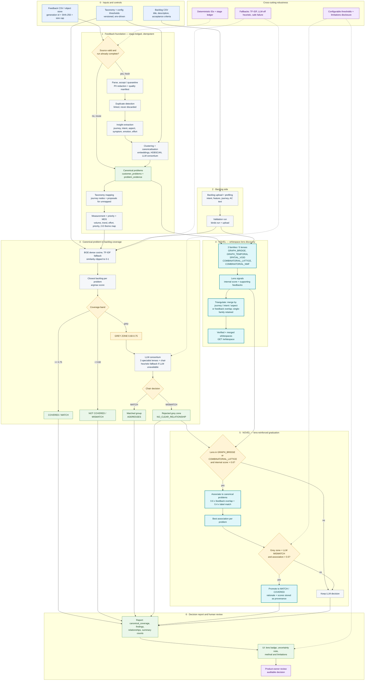

# End-to-End Process Flow — Feedback Data to Problem–Backlog Gap Coverage

## 1. Value-stream flowchart



## 2. Decision-sequence flowchart

```mermaid
sequenceDiagram
    autonumber
    actor PO as Product owner
    participant SRC as Feedback + backlog sources
    participant PIPE as Feedback pipeline
    participant CP as Canonical problem store
    participant COV as Coverage engine
    participant LLM as LLM consortium
    participant LENS as Whitespace lenses
    participant RPT as Report + UI

    PO->>SRC: Supply feedback CSV and backlog CSV
    SRC->>PIPE: Ingest by generation with checksum and size gate
    activate PIPE
    PIPE->>PIPE: Accept, quarantine, redact PII, link duplicates
    PIPE->>CP: Extract insights, cluster, canonicalise, map taxonomy
    CP-->>PIPE: Canonical problems, evidence, priority, MDS coordinates
    PIPE-->>RPT: Publish stage-ledged run summary
    deactivate PIPE

    RPT->>COV: Validate backlog against canonical problems
    activate COV
    COV->>COV: BGE cosine / TF-IDF fallback; closest backlog; band thresholds
    alt coverage >= 0.75
        COV-->>RPT: Covered + MATCH
    else coverage < 0.60
        COV-->>RPT: Not covered + MISMATCH
    else grey zone 0.60-0.75
        COV->>LLM: 3 specialist lenses + chair adjudicate
        LLM-->>COV: MATCH or MISMATCH with rationale
        COV-->>RPT: Grey-zone decision + provenance
    end

    Note over LENS,COV: NOVEL: lens signals re-inforce gaps the LLM did not match
    RPT->>LENS: Read same run and upload
    activate LENS
    LENS->>LENS: 5 lenses / 3 families emit scored signals
    LENS->>LENS: Shortlist GRAPH_BRIDGE + COMBINATORIAL_LATTICE with internal score > 0.6
    LENS->>CP: Associate via 0.6 feedback overlap + 0.4 label agreement
    CP-->>LENS: Best association per canonical problem
    alt grey zone + LLM MISMATCH + association > 0.5
        LENS-->>COV: Promote to MATCH / COVERED with provenance
    else below gate
        LENS-->>COV: Keep LLM decision
    end
    deactivate LENS
    deactivate COV

    COV-->>RPT: Findings, canonical coverage, summary, limitations
    RPT-->>PO: Lens badge, uncertainty note, method limitations
    PO->>RPT: Record product-owner review decision
    Note over PIPE,COV: Deterministic IDs · stage ledger · configurable thresholds · LLM fallbacks
```
