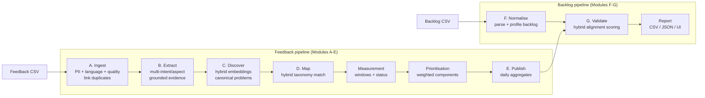
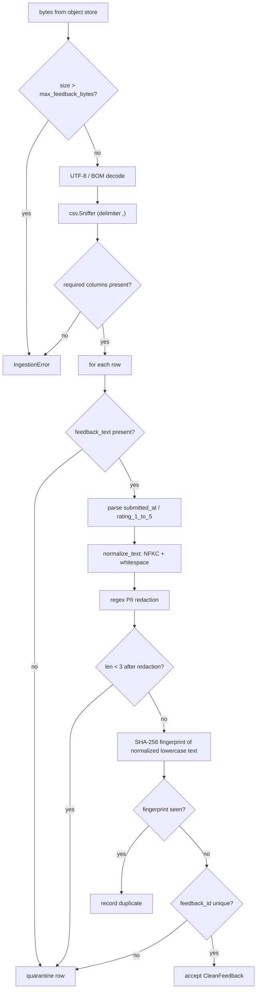
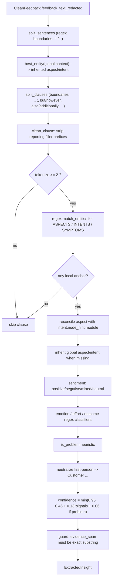
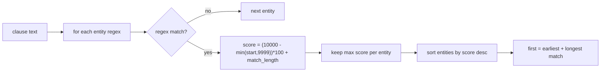
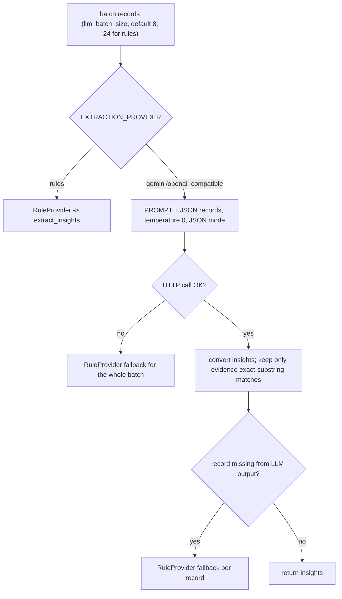
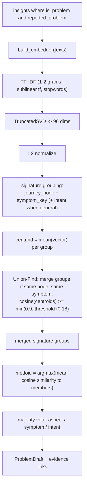
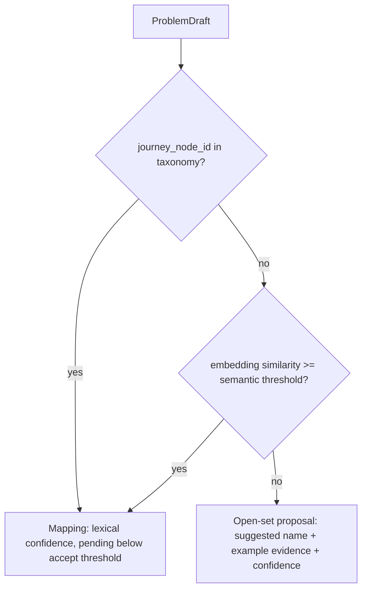
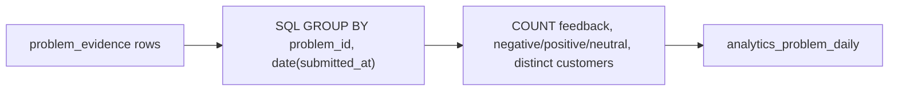
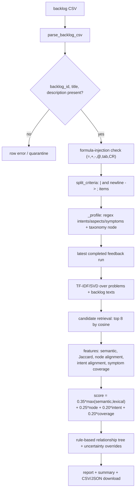
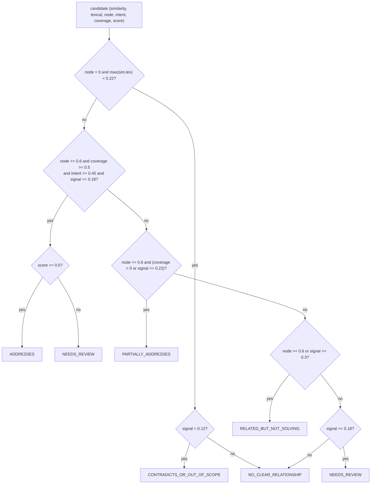

# Pipeline Algorithms: Where and How They Are Used

This document maps every algorithm in the feedback and backlog pipelines to the exact stage that uses it, the implementation file, and the parameters/thresholds applied. Diagrams use Mermaid (rendered on GitHub/GitLab).

> Source of truth: `backend/app/services/pipeline.py`, `backend/app/services/ingestion.py`, `backend/app/services/backlog.py`, and `backend/app/intelligence/*`.

---

## 1. End-to-end pipeline

| Stage | Entry point | Core algorithms |
| --- | --- | --- |
| validate_source | `pipeline.py:94` | object stat + SHA-256 + size guard |
| module_a_ingest | `ingestion.py` + `intelligence/{pii,language,duplicates,quality}.py` | CSV sniffing, schema checks, Presidio/regex PII redaction, language detection, MinHash/LSH near-duplicates, repeat complaints, data-quality checks. Duplicates are linked, never discarded. |
| module_b_extract | `extractor.py` / `providers.py` | regex lexicon matching, multi-intent/multi-aspect output, field confidence, evidence verification, technical root cause forced to `unknown`, LLM fallback |
| module_c_discover | `clustering.py` | TF-IDF/SVD + optional sentence-transformer/Vertex embeddings, signature grouping, Union-Find merge, cosine medoid, canonical descriptions |
| module_d_map | `clustering.py` + `taxonomy.py` | weighted lexical/semantic taxonomy scoring, open-set thresholds, ancestor graph walk, proposal generation |
| measurement_engine | `intelligence/measurement.py` | windowed metrics with explicit unit, status, provenance and `NO_DATA` handling |
| priority_engine | `intelligence/prioritization.py` | transparent weighted component scores, missing-metric reporting, escalation rules |
| mds_engine | `intelligence/mds.py` + `services/mds.py` | theme centroids, pairwise cosine distances, metric MDS projection, nearest-neighbour similarities, stress diagnostics |
| module_e_publish | `pipeline.py` + `repository.py` | SQL `GROUP BY` daily aggregation + measurement/priority snapshots |
| module_f_normalise | `backlog.py:238` | regex profiling + taxonomy alias/best-node mapping |
| module_g_validate | `backlog.py:276` | embedding retrieval, Jaccard, weighted score, rule-based relationship tree |

---

## 2. Module A - Ingest, validate, redact, dedupe

**Algorithms and where they live**

| Algorithm | How it is used | Code |
| --- | --- | --- |
| Bounded size check | Rejects source objects larger than `max_feedback_bytes` | `pipeline.py:98`, `ingestion.py:81` |
| CSV dialect detection | `csv.Sniffer().sniff(text[:4096], delimiters=",")`; falls back to `csv.excel` | `ingestion.py:89` |
| Header validation | All `REQUIRED_COLUMNS` must exist | `ingestion.py:14`, `ingestion.py:94` |
| Row cap | Stops after `pipeline_max_rows` (default 25000) | `ingestion.py:106` |
| Timestamp parsing | `datetime.fromisoformat`, `Z -> +00:00`, naive -> UTC | `ingestion.py:48` |
| Rating validation | `int(float(...))`, must be 1..5, else quarantine | `ingestion.py:61` |
| Unicode normalization | NFKC, removes zero-width/non-breaking spaces, collapses whitespace | `text.py:47` |
| Regex PII redaction | Ordered patterns: EMAIL, CARD, PHONE, AADHAAR, ACCOUNT, IFSC, UPI, NAME, URL | `text.py:7` |
| Residual long-number redaction | Bare digit runs of length >= 9 become `[NUMBER]` | `text.py:62` |
| Content fingerprint | `sha256(normalize_text(text).lower())` | `ingestion.py:74` |
| Exact-duplicate detection | Fingerprint map keeps first seen row | `ingestion.py:144` |
| Deterministic fallback ID | `FB-` + SHA-1 of `source_type|submitted_at|fingerprint` | `ingestion.py:155` |

PII patterns (`text.py:7-17`) operate as a sequentially applied substitution pipeline; each match is replaced with `[LABEL]` and the label set is recorded in the run manifest.

---

## 3. Module B - Insight extraction (Module B)

### 3.1 Text segmentation

| Algorithm | Detail | Code |
| --- | --- | --- |
| Sentence splitting | Regex on `[.!?]+` / `;+` with `min_chars=2` | `text.py:103` |
| Clause splitting | Same boundary helper with clause regex (`but`, `however`, `also`, `on top of that`, ...), `min_chars=8` | `text.py:80`, `text.py:108` |
| Reporting-prefix stripping | Iteratively removes phrases like "today,", "also,", "I wanted to share this:" | `text.py:19`, `text.py:113` |
| Tokenization | Lowercase `[a-z0-9][a-z0-9'-]*`, drop stopwords and tokens <= 2 chars | `text.py:126` |

### 3.2 Lexicon entity matching

- `match_entities` scores an entity by **earliest occurrence first, then longest match** (`lexicon.py:231`). This is a greedy "primary anchor" heuristic, not probabilistic.
- `best_entity` just returns the top match (`lexicon.py:248`).
- Data sets: 38 intents, 44 aspects, 38 symptoms (`lexicon.py:35`, `lexicon.py:75`, `lexicon.py:125`).

### 3.3 Aspect/intent reconciliation

`extractor.py:92-117` reconciles an incidental local aspect against the intent's `node_hint` module:

1. If intent and aspect belong to different modules, prefer an aspect whose `node_id` exactly equals the intent's `node_hint`.
2. Otherwise prefer any aspect in the same module as the intent's `node_hint`.
3. Otherwise clear the aspect so the inherited/global aspect can be applied.

This prevents phrases such as "transaction reference" from overriding the actual object of the complaint (e.g. a statement).

### 3.4 Sentiment and behavioural signals

| Signal | Algorithm | Code |
| --- | --- | --- |
| Sentiment | Lexicon hit counting: -1 per negative term, +1 per positive term; intensifier adds -0.5 / +0.25; negator in prefix flips positive -1; mixed if both sides and `|score| <= 1.5`; thresholds `>0.4` / `<-0.4` | `lexicon.py:253` |
| Emotion | Ordered regex lookup: frustration, confusion, anxiety, disappointment, satisfaction | `lexicon.py:280` |
| Effort | Ordered regex: high > medium > low, else unknown | `lexicon.py:293` |
| Outcome | Ordered regex: abandoned > blocked > failed > workaround_used > completed > unknown | `lexicon.py:303` |
| Is problem | negative/mixed, or symptom present and not positive, or outcome blocked/failed/abandoned | `extractor.py:48` |
| Confidence | `0.46 + 0.13 * (#aspect + #symptom + #intent + non-neutral sentiment) + 0.06 if problem`, capped 0.95 | `extractor.py:132` |

### 3.5 LLM extraction path and fallback

- Prompt is fixed at `PROMPT_VERSION = "extraction-1.0"` (`providers.py:15`).
- Evidence hallucination guard: `evidence not in record.feedback_text_redacted -> drop` (`providers.py:118`).
- `_enrich_insight` then fills a missing journey node through the lexicon aspect table or `Taxonomy.best_node` (`pipeline.py:282`).

---

## 4. Module C - Discover canonical problems

**Embedding algorithms**

| Provider | Algorithm | Parameters | Code |
| --- | --- | --- | --- |
| Local (default) | TF-IDF then truncated SVD (LSA) then L2 normalization | `ngram_range=(1,2)`, `min_df=1`, `max_df=0.95`, `sublinear_tf=True`, `stop_words="english"`, `components=max(2, min(dim, n_features-1, n_samples-1))` | `embeddings.py:11`, `embeddings.py:26` |
| Gemini | Batch embeddings API, L2 normalized | 100 texts per request | `embeddings.py:60` |
| Similarity | Cosine via dot product on normalized vectors, clipped to `[-1, 1]` | - | `embeddings.py:103` |

**Clustering algorithms**

| Step | Algorithm | Detail | Code |
| --- | --- | --- | --- |
| Base grouping | Deterministic key grouping | `journey_node\|symptom_key`, or `journey_node\|general\|intent` | `clustering.py:39`, `clustering.py:71` |
| Group merge | Union-Find (path compression) | Merge only if same non-`unmapped` node, same symptom key, and centroid cosine `>= min(0.9, 0.64 + 0.18) = 0.82` | `clustering.py:76`, `clustering.py:99` |
| Representative | Medoid | Member whose mean cosine similarity to all members is highest | `clustering.py:119` |
| Labels | Majority vote / `most_common` | Dominant aspect, symptom key, intent | `clustering.py:124` |
| Aggregates | Set/Counter aggregation | Distinct customers, negative count, first/last seen, source counts | `clustering.py:138` |
| IDs | SHA-1 truncation | `CP-` / `CL-` from the signature | `clustering.py:27` |

The merge threshold is effectively `0.82` with the default `clustering_similarity_threshold=0.64` (`config.py:58`).

---

## 5. Module D - Hybrid taxonomy mapping

Taxonomy matching uses a **weighted lexical scorer first, then an embedding-similarity fallback**, not an ML classifier (`taxonomy.py:92`, `clustering.py`). `TAXONOMY_ACCEPT_THRESHOLD` controls mapping acceptance; `TAXONOMY_SEMANTIC_THRESHOLD` gates the fallback; `TAXONOMY_OPEN_SET_THRESHOLD` marks proposals that are near the existing taxonomy boundary. Low-confidence mappings are stored as `pending_review`.

| Rule | Weight |
| --- | --- |
| Exact display-name phrase match | +3.0 |
| Exact synonym/alias phrase match | +2.2 |
| Token overlap with display name / synonyms / aliases | +0.5 per shared token |
| Token overlap with description | +0.25 per shared token |
| Module node penalty | score x 0.92 |
| Acceptance threshold in `best_node` | `>= 1.4` (1.4 default; backlog profiling uses 2.0) |

Ancestor traversal (`taxonomy.ancestors`, `module_for`, `path_label`) is a bounded graph walk over `parent_id` with cycle protection, used for module alignment and human-readable paths (`taxonomy.py:69`).

---

## 6. Module E - Publish

- Daily aggregation is done in SQLite SQL, deleting and rebuilding rows per run (`repository.py:427`).
- Run summary metrics and version stamps (`model_version`, `taxonomy_version`, `schema_version`) are written to the run record (`pipeline.py:215`).

---

## 7. Modules F-G - Backlog normalisation and validation

### 7.1 Backlog normalisation algorithms

| Algorithm | Detail | Code |
| --- | --- | --- |
| CSV parsing / sniffing | Same `csv.Sniffer` approach as feedback ingestion | `backlog.py:73` |
| Required-field validation | `backlog_id`, `title`, `description`; duplicate IDs rejected | `backlog.py:96` |
| Formula-injection guard | Cells starting with `=`, `+`, `-`, `@`, tab, CR are flagged and neutralised on export | `backlog.py:60`, `backlog.py:105` |
| Acceptance-criteria splitting | `|` and newlines converted to `;`, then split and trimmed | `backlog.py:54` |
| Profiling | Regex entity matching + taxonomy product-area alias map | `backlog.py:238`, `taxonomy.py:126` |
| Node fallback | product_area alias -> aspect `node_id` -> `best_node(threshold=2.0)` | `backlog.py:247` |

### 7.2 Validation algorithms

| Feature | Algorithm | Formula / rule | Code |
| --- | --- | --- | --- |
| Semantic similarity | Cosine similarity of TF-IDF/SVD vectors | `problem_vectors @ backlog_vectors[i]` | `backlog.py:307` |
| Candidate retrieval | Top-K sort | top 8 candidate problems per backlog item | `backlog.py:313` |
| Lexical overlap | Jaccard index on token sets | `\|A ∩ B\| / \|A ∪ B\|` | `text.py:138`, `backlog.py:318` |
| Node alignment | Taxonomy graph comparison | exact node = 1.0, same module = 0.6, else 0.0 | `backlog.py:483` |
| Intent alignment | Lexicon comparison | intent match = 1.0, aspect match = 0.8, intent.node_hint = 0.7, else 0.0 | `backlog.py:509` |
| Symptom coverage | Dictionary term lookup | covered symptoms / detected symptoms (0..1) | `backlog.py:539` |
| Alignment score | Weighted linear combination | `0.35 * max(semantic, lexical) + 0.25 * node + 0.20 * intent + 0.20 * coverage` | `backlog.py:318` |

### 7.3 Relationship decision tree

Post-processing overrides (`backlog.py:334-340`):

- `ADDRESSES`/`PARTIALLY_ADDRESSES` with fewer than 2 supporting feedback mentions -> `NEEDS_REVIEW`.
- `ADDRESSES` with acceptance-criteria coverage in `[0.25, 0.45)` -> `NEEDS_REVIEW`.

### 7.4 Overall alignment roll-up

Priority ranking used to pick the best finding and produce the item-level verdict (`backlog.py:580`):

| Relationship | Priority |
| --- | --- |
| ADDRESSES | 5 |
| PARTIALLY_ADDRESSES | 4 |
| NEEDS_REVIEW | 3 |
| RELATED_BUT_NOT_SOLVING | 2 |
| NO_CLEAR_RELATIONSHIP | 1 |
| CONTRADICTS_OR_OUT_OF_SCOPE | 0 |

| Verdict | Condition |
| --- | --- |
| `strong` | best ADDRESSES has score `>= 0.55` and `>= 2` supporting mentions |
| `needs_review` | ADDRESSES below those gates, or any NEEDS_REVIEW |
| `partial` | any PARTIALLY_ADDRESSES |
| `weak` | only RELATED_BUT_NOT_SOLVING |
| `unsupported` | no findings / only no-relationship |

`uncovered_high_evidence_problems` = problems not addressed by any finding and with `evidence_count >= 5` (`backlog.py:416`).

---

## 8. Algorithm quick-reference

| # | Algorithm | Type | Used in |
| --- | --- | --- | --- |
| 1 | UTF-8/BOM decode + `csv.Sniffer` | Deterministic parsing | A, F |
| 2 | JSON/CSV schema validation | Rule-based validation | A, F |
| 3 | Regex PII redaction | Pattern matching | A |
| 4 | NFKC + whitespace normalization | Text normalization | A, B |
| 5 | SHA-256 content fingerprint | Hashing / exact dedupe | A |
| 6 | Regex sentence/clause segmentation | Pattern matching | B |
| 7 | Lexicon regex entity extraction | Greedy earliest-match scoring | B, F, G |
| 8 | Aspect-intent reconciliation | Rule/heuristic | B |
| 9 | Lexicon sentiment scoring | Weighted keyword counting | B |
| 10 | Regex emotion/effort/outcome classifiers | Ordered rule matching | B |
| 11 | Heuristic confidence | Linear formula | B |
| 12 | LLM structured extraction + rule fallback | Prompt + JSON parse | B |
| 13 | TF-IDF + TruncatedSVD (LSA) | Unsupervised vectorization | C, G |
| 14 | Gemini embeddings | Neural embeddings | C (optional) |
| 15 | L2 normalization + cosine similarity | Vector math | C, G |
| 16 | Signature key grouping | Deterministic grouping | C |
| 17 | Union-Find | Graph connectivity | C |
| 18 | Centroid cosine merge | Similarity thresholding | C |
| 19 | Medoid selection | Representative sampling | C |
| 20 | Majority vote | Aggregation | C |
| 21 | Weighted lexical taxonomy scoring | Scoring / thresholding | B, D, F |
| 22 | Taxonomy ancestor graph walk | Tree traversal | D, G |
| 23 | SQL `GROUP BY` aggregation | Relational aggregation | E |
| 24 | Acceptance-criteria parsing | Delimiter splitting | F |
| 25 | CSV formula-injection detection | Security rule | F, report export |
| 26 | Jaccard similarity | Set similarity | G |
| 27 | Weighted hybrid alignment score | Linear combination | G |
| 28 | Rule-based relationship decision tree | Decision rules | G |
| 29 | Priority ranking + thresholds | Decision rules | G |

---

## 9. Parameters that change behaviour

| Setting | Default | Effect |
| --- | --- | --- |
| `EXTRACTION_PROVIDER` | `rules` | Chooses `RuleProvider` vs `LLMProvider` |
| `LLM_BATCH_SIZE` | `8` | LLM batch size (rules path uses 24) |
| `EMBEDDING_PROVIDER` | `local` | TF-IDF/SVD vs Gemini embeddings |
| `EMBEDDING_DIMENSIONS` | `96` | SVD output dimensions |
| `CLUSTERING_SIMILARITY_THRESHOLD` | `0.64` | Group merge threshold (`+0.18`, capped 0.9) |
| `PIPELINE_MAX_ROWS` | `25000` | Feedback row cap |
| Taxonomy `best_node` threshold | `1.4` (ingestion) / `2.0` (backlog) | Minimum lexical score to accept a mapping |
| Alignment weights | `0.35 / 0.25 / 0.20 / 0.20` | Semantic / node / intent / coverage mix |
| Candidate retrieval `K` | `8` | Problems compared per backlog item |
| High-evidence uncovered gate | `5` | Minimum mentions for the coverage gap list |

---

## 10. Design guardrails

1. **Evidence-first**: every insight's `evidence_span` must be an exact substring of redacted source; LLM output is dropped otherwise (`extractor.py:165`, `providers.py:118`).
2. **Similarity is retrieval, not decision**: cosine similarity only selects candidates; the final relationship uses node, intent, coverage and score rules (`backlog.py:467`, `backlog.py:555`).
3. **Determinism by default**: `rules` provider + TF-IDF/SVD + fixed thresholds/seed (`random_state=42`) produce reproducible local runs.
4. **No invented root cause**: the prompt forbids inferred causes and the rule extractor only labels observable symptoms/outcomes.

---

## 11. Module A enhancements - PII, language, duplicates and quality

### 11.1 PII providers

`PII_PROVIDER=regex|presidio|hybrid` selects the redaction path. Presidio is imported lazily and banking recognisers are registered for IFSC, UPI, Aadhaar, account numbers, cards, phone numbers and email. Any import or model failure falls back to the deterministic regex path and records `provider_used="regex"` in metadata. Original text is retained only for provenance; every API, insight and backlog flow uses the redacted text.

### 11.2 Language detection

`LANGUAGE_DETECTION_PROVIDER=heuristic|langdetect|fasttext` returns `(language, confidence, supported, provider)`. The heuristic is deterministic and script-aware, with Hinglish markers. Customer text is never translated or overwritten.

### 11.3 Duplicate policy

Three mechanisms are deliberately separate:

1. **Exact duplicates** - SHA-256 content fingerprint.
2. **Near-duplicate candidates** - token 3-shingles, MinHash signatures and LSH banding; a candidate is kept only when exact Jaccard similarity is at or above `NEAR_DUPLICATE_THRESHOLD`.
3. **Repeat complaints** - same `synthetic_customer_ref`, same lexical problem identity, inside `REPEAT_COMPLAINT_WINDOW_DAYS`.

All relationships are persisted in `feedback_duplicate_candidates` and exposed through `GET /api/v1/duplicates`. Complaints are **never dropped**. The only rejections are invalid rows (missing text/timestamp/rating, duplicate source IDs within one upload).

### 11.4 Data quality

`run_data_quality_checks` reports explicit statuses (`PASS`, `WARN`, `FAIL`, `NOT_AVAILABLE`) for empty feedback, text length, corrupted characters, timestamps, source distribution, unsupported language, duplicate rate and encoding. Results are exposed through `GET /api/v1/data-quality`.

---

## 12. Measurement and prioritisation

### 12.1 Measurement engine

Metrics are computed independently over four explicit windows (`MEASUREMENT_WINDOW_DAYS`, `TREND_BASELINE_DAYS`, `TREND_CURRENT_DAYS`):

- lifetime;
- the configured measurement window (90 days by default);
- the current trend window (30 days by default);
- the previous trend window (30 days by default).

Every snapshot includes `unit`, `status`, `calculation_method`, `measurement_window_start/end`, `input_record_count`, `source_availability`, a quality indicator and `metadata.window_coverage`. Core metrics are emitted with a window suffix (`_lifetime`, `_90d`, `_30d`, `_previous_30d`); canonical names are aliases of the measurement window.

Missing or out-of-coverage windows are `NO_DATA`/`INSUFFICIENT_DATA`, never zero. A covered window with no matching records is a true `OK` zero. Metrics: `evidence_volume`, `distinct_customers`, `negative_share`, `repeat_complaint_count`, `source_diversity`, growth metrics (`volume_growth_abs`, `volume_growth_pct`, `customer_growth_abs`, `customer_growth_pct`, `negative_share_change`), compatibility metric `assessment_velocity_delta`, plus daily `feedback_count`/`negative_count`.

### 12.2 Priority engine

The priority score is a transparent weighted sum of:

| Component | Default weight | Evidence inputs |
| --- | --- | --- |
| Customer impact | 0.30 | distinct customers, negative share, repeat complaints |
| Business risk indicator | 0.30 | grounded risk terms (fraud, unauthorised, blocked, duplicate payment) + negative share |
| Operational impact | 0.15 | evidence volume, source diversity, customer breadth |
| Trend | 0.15 | current vs previous 30-day volume growth |
| Strategic | 0.10 | journey module weight |

Inputs are read from the stored measurement snapshots. Missing inputs are returned in `missing_metrics`; they contribute zero and reduce `supporting_evidence.data_completeness`. MDS is not used as severity, and sentiment is not treated as churn.

Risk terms produce an **indicator** score. Detected terms are stored in `supporting_evidence.risk_indicators`; verification is explicitly `NOT_VERIFIED` with no verifier or source unless a real verification source is added. Priority snapshots persist the measurement window start/end. `GET /api/v1/priorities` and `GET /api/v1/problems/{id}/priority` expose the result and methodology version.

### 12.3 MDS theme map

`mds_engine` treats each canonical customer problem as a theme and projects semantic similarity into two dimensions. It does not re-cluster themes.

1. Build one representative vector per theme: the centroid of member `extracted_insights.embedding_json` vectors when all themes have vectors with a consistent dimensionality; otherwise recompute every theme vector from theme text with one embedder. Embedding spaces are never mixed.
2. Compute pairwise cosine distance, `1 - cosine_similarity`, clipped to `[0, 2]`.
3. Run metric MDS with `sklearn.manifold.MDS` (`n_components=2`, precomputed dissimilarity, `MDS_RANDOM_STATE`, `MDS_MAX_ITER`, `n_init=4`). Two themes are placed symmetrically; one theme is insufficient for a map.
4. Persist raw and display coordinates, top `MDS_NEIGHBORS` neighbours, stress and methodology parameters. Positions are semantic only and may rotate or reflect between runs.

Business meaning is joined at read time: `evidence_volume` (bubble size), `negative_share` (default colour; labelled negative evidence share, not severity), `priority_score` / `business_risk_score` (alternative colours), `volume_growth_pct` (outline), and latest backlog `coverage_type` (dashed outline for uncovered / needs review). Theme-map failure is isolated and never fails the feedback pipeline. Endpoints: `GET /api/v1/problem-map`, `POST /api/v1/problem-map/recompute`, `GET /api/v1/problem-map/{problem_id}`.

---

## 13. Module F/G enhancements - hybrid retrieval and coverage

Backlog validation now uses `HybridRetriever`: dense embeddings plus sparse TF-IDF, weighted by `RETRIEVAL_DENSE_WEIGHT`/`RETRIEVAL_SPARSE_WEIGHT`. An optional cross-encoder reranker runs only when installed and configured; otherwise the deterministic hybrid ranking is used.

Optional backlog columns now include `intended_outcome`, `customer_intent`, `target_feature`, `target_journey`, `functional_scope` and `organisational_objective`. The validator still requires journey, intent, symptom coverage and acceptance-criteria checks before assigning a relationship. It never auto-approves or auto-rejects a backlog. Coverage rows and candidate rankings are persisted and exposed through `GET /api/v1/backlog-validation-reports/{id}/coverage`.

---

## 14. Guarded advanced analytics

`intelligence/advanced.py` refuses to compute survival or conjoint analyses without their required inputs:

- Survival requires event, duration, time origin and censoring data. Feedback sentiment is not an event.
- Conjoint requires an experimental design with controlled attribute levels and choice responses. Ordinary feedback is not a design.

---

## 15. Problem dimensions - additive FAMD layer

Problem dimensions are computed from canonical-problem and measurement evidence and published separately from the feedback pipeline. They are an exploratory association layer, not causal findings, severity, priority or a replacement for the MDS theme map.

1. **Feature snapshot** - the builder emits a versioned, window-aware feature row per canonical problem. Inputs cover journey module/feature/stage, aspect, symptom category, customer intent, volume, distinct customers, negative share, repeat rate, source diversity, high-effort share, failure share, negative-emotion share, volume growth, absolute volume growth, customer growth, negative-share change, assessment velocity and evidence confidence. Active, supplementary and excluded roles are configurable; all-null or zero-variance features are excluded from fitting. IDs, titles, free text, raw feedback, MDS coordinates, `priority_score` and priority-derived fields are forbidden. Missing measurement windows remain missing (`None`), not zero. Attributes not present in the source data model are documented as unavailable rather than fabricated.
2. **Quality gates** - row count, duplicate IDs, forbidden fields, overall/per-column missingness, sparse categories, zero-variance numerics, duplicate numeric vectors and invalid rate denominators. Failed gates block the run before model fitting; warnings are persisted.
3. **Preprocessing** - missing numeric values are median-imputed and category values are filled with an explicit `__MISSING__` level for fitting only. The imputation policy and fitted medians are recorded on the run. Stored features retain their missing values.
4. **FAMD** - `prince.FAMD` is fitted with a configured random state. The implementation retains up to the configured component count, records eigenvalues, explained/inertia variance, signed row coordinates and squared cosines, variable contributions and category contributions. Problems are assigned to their dominant absolute coordinate with a configurable ambiguity threshold. Signed row coordinates are exposed as canonical-problem coefficients: `CP_i = beta_i1*F1 + ... + beta_ik*Fk`. They are associations, not causal effects or regression betas. A descriptive squared-coordinate share is also stored: `relative_squared_coordinate_share_pct = s_ij^2 / sum_j(s_ij^2) * 100`; it is null when every coordinate for the problem is zero.
5. **Diagnostics** - optional bootstrap runs compare component alignment and flag unstable dimensions. Optional EFA uses `sklearn.decomposition.FactorAnalysis` on numeric features only and is stored as a comparison, not as the publishing model. Quality checks, warnings, convergence and explained variance are persisted.
6. **Interpretation and gating** - deterministic candidate factor names/descriptions plus top variables and representative problems are proposed from the fitted contributions. Proposed labels are drafts for domain-expert review and are not hardcoded business concepts. An analyst can approve, rename, request revision or reject each dimension. No dimension is publishable until every retained dimension is approved.
7. **Publication** - publishing requires an approved, non-rejected run and writes immutable definitions, contributions, scores, relative shares, equations, memberships, trends and publication metadata. Reads of latest published dimensions resolve through the append-only `dimension_publications` table, so unpublished runs never replace the current publication. A previously published run can be republished by an analyst to restore it as the latest publication (rollback); this appends a new publication record rather than mutating the previous one. Run-specific endpoints remain available for review and audit.

Lifecycle: `QUEUED -> BUILDING_FEATURES -> VALIDATING_DATA -> FITTING_FAMD -> VALIDATING_RESULTS -> PENDING_REVIEW -> APPROVED -> PUBLISHED`; failures end in `FAILED` and rejected runs in `REJECTED`. The layer is controlled by `ENABLE_PROBLEM_DIMENSIONS`, `ENABLE_PROBLEM_DIMENSION_EFA`, the `PROBLEM_DIMENSION_*` settings, and feature role settings (`PROBLEM_DIMENSION_ACTIVE_FEATURES`, `PROBLEM_DIMENSION_SUPPLEMENTARY_FEATURES`, `PROBLEM_DIMENSION_EXCLUDED_FEATURES`).

---

## 16. Problem portfolio narrative

The portfolio layer serializes an approved factor run, the latest OK MDS snapshot and the completed feedback run into a deterministic, hashed payload. It includes approved factor nomenclature and profiles, signed problem coefficients, measurements, priorities, equations, Euclidean MDS neighbours, backlog coverage and data-quality constraints. Missing measurements remain null with their status and are never treated as zero.

The full serialization is persisted and content-hashed. The Gemini provider receives a token-bounded context derived from it: the full factor catalogue, every problem in a compact index and detailed evidence for the highest-priority problems. The provider returns the `PortfolioNarrative` Pydantic contract using the official `google-genai` SDK with JSON Schema response mode.

A deterministic validator rejects technical IDs in prose, unapproved factor names, causal language around FAMD coefficients or coordinate shares, business interpretation of MDS axes, ungrounded references, unqualified provisional factors and missing-as-zero language. `PASSED` and `WARNING` narratives complete the run; `FAILED` triggers corrective retries. Regeneration reloads the stored serialization and does not rerun MDS or FAMD. Narratives and validation results are append-only. See [problem_portfolio.md](problem_portfolio.md) for endpoints, settings and UI details.
